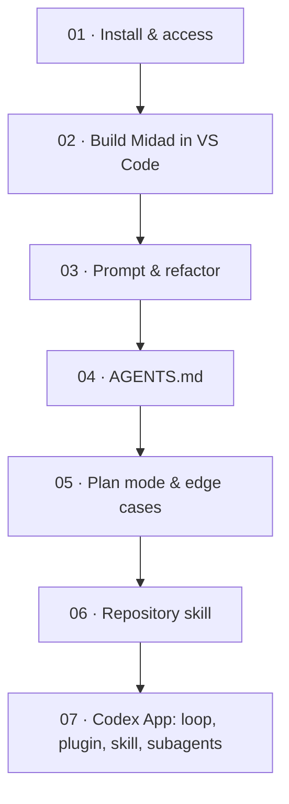
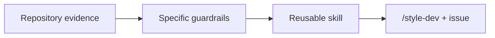

# MODULE 02 — AGENTIC CODING

> **TAWLIID | توليد** · Agentic Harness Engineering · Instructor-led practical lab

**A field guide for teaching, experimenting, and repeating every exercise independently.** Follow the stations in order: setup → build → refine → establish agent rules → plan → create a skill → explore Codex App workflows.

  

---

## 🧭 At a glance



| Workshop lens | What you will practice | Visible evidence |
| :-- | :-- | :-- |
| **Build** | From a natural-language feature request to a working interface | Midad landing page and book section |
| **Guide** | Give coding agents precise context, constraints, and local conventions | Prompt iterations, `AGENTS.md`, plan |
| **Extend** | Package repeatable behavior and coordinate research | `/style-dev`, YouTube skill, multi-agent research request |

> [!IMPORTANT]
> **Source fidelity:** Every command, URL, exercise prompt, and sample task below is reproduced as supplied, including original spelling and formatting. Teaching notes, expected observations, and checkpoints are additions—not instructions to rewrite the source prompts.

### Before you begin

- Have **Node.js and npm**, a terminal, VS Code, and access to Codex where required.
- Work in a practice project. Check your current directory before asking an agent to modify files.
- Keep the instructor's screen and each trainee's working copy aligned at the end of every checkpoint.
- Prompts are presented in **copy-ready text blocks**. Paste each exercise only when you reach its station.

---

## 01 / Environment setup

<details open><summary><strong>01A · Install Codex CLI</strong></summary>

**Original instruction**

```text
*install codex cli*
npm install -g @openai/codex@latest
```

**Instructor cue:** Introduce the distinction between a terminal-based coding agent and its graphical application. Let trainees run the command and confirm installation before proceeding. A globally installed package may require appropriate local permissions.

**Checkpoint:** Each participant can open a terminal and locate their Codex CLI installation.

</details>

<details open><summary><strong>01B · Install Codex App</strong></summary>

**Original instruction**

```text
*install codex app*
https://openai.com/codex/?utm_source=chatgpt.com
```

**Instructor cue:** Demonstrate where the app fits into the same agentic workflow, and distinguish access or operating-system availability from the CLI installation above.

**Checkpoint:** Participants know which interface they will use in each subsequent activity.

</details>

---

## 02 / Using Codex in VS Code · Midad

<table><tr><td>🎯 <strong>Scenario</strong></td><td>Build and incrementally extend an Arabic study-notes landing page.</td></tr><tr><td>🧩 <strong>Focus</strong></td><td>Project scoping, RTL design, targeted edits, and an observable UI result.</td></tr><tr><td>📁 <strong>Target</strong></td><td><code>AIE2631/module-02-agentic-coding/</code> (retain the exact target wording in the original prompt).</td></tr></table>

### Experiment 2.1 · First build

**Original prompt — unchanged**

```text
*Using Codex in VS*
*Midad*
1
Build a sleek, minimalist, and modern landing page for an Arabic study notes platform called **Midad (مِداد)**.
**Target directory:**\
`AIE2631/module-02-agentic-coding/`Midad
```

**Observe:** How does the agent choose the layout, language direction, typography, files, and development workflow from a compact brief?

**Checkpoint:** Open the generated page, inspect the Arabic presentation, and confirm the intended project directory.

### Experiment 2.2 · Small, scoped change

**Original prompt — unchanged**

```text
2
Add a minimalist Arabic RTL book offer section to the Midad landing page showing only the book title and price, matching the existing design; modify only index.html
```

**Observe:** Compare the new section with the existing visual language. Inspect the diff: was only `index.html` changed?

> [!TIP]
> **Teaching moment — scope is a control surface.** A constraint such as “modify only index.html” gives trainees something objective to verify in a code diff.

---

## 03 / Prompting laboratory

### Experiment 3.1 · Basic feature request

**Original prompt — unchanged**

```text
*PROMPTING*

Add a second button labeled "Remove Book".
It should render for example: "Book #4 removed from the library."
```

**Discussion:** What is specified, and what must the coding agent infer? Pay particular attention to the output message, existing event handlers, and code organization.

### Experiment 3.2 · Structured request: TASK → CONTEXT → OUTPUT

**Original prompt — unchanged**

```text
--------------
TASK
Add a second button labeled "Remove Book".
It should render for example: "Book #4 dropped."

CONTEXT
Inspect the existing code and shared logic where possible. Avoid duplicating event handlers.

OUTPUT
Keep the cod DRY as possible and easy to extend if we add extra buttons later.
```

| Prompt layer | What to inspect in the agent's result |
| :-- | :-- |
| **TASK** | Does the button appear, and is the requested message rendered? |
| **CONTEXT** | Did the agent inspect existing handlers and reuse shared logic? |
| **OUTPUT** | Is the implementation easy to extend with more actions? |

**Checkpoint:** Compare the two versions of the request and the resulting changes. Notice that their example output strings are deliberately different; evaluate each against its own prompt.

### Experiment 3.3 · Contextual prompting

**Original examples — unchanged**

```text
*CPrompting*

[Refactor this function to follow the same style as the model function.] [Complete the todo in api.js]
```

**Instructor cue:** Use the current repository to illustrate why a reference function, an existing `TODO`, and surrounding code provide useful local context. Ask trainees what files the agent must inspect before editing.

---

## 04 / Repository instructions · `AGENTS.md`

**Original note — unchanged**

```text
*Agents.md*
_ using PROMPTING DEMO _
```

**Lab focus:** Revisit the prompting demo while discussing persistent, repository-specific guidance. Show where project rules belong, how they affect repeated tasks, and how to separate enduring conventions from one-off user requests.

**Checkpoint:** Each trainee can explain the difference between the immediate prompt and standing repository guidance.

---

## 05 / Plan mode & edge cases

**Original note — unchanged**

```text
*Plan Mode / Edge CASES*
_ using PROMPTING DEMO _
```

**Lab focus:** Return to the same feature request. Before implementation, inspect the proposed sequence of changes and discuss cases such as a missing book, repeated clicks, invalid IDs, or pre-existing behavior. These are **discussion examples**, not additional source prompts.

**Checkpoint:** Participants can identify an assumption, a failure mode, and a useful test before accepting a change.

---

## 06 / Create a repository-specific skill

<blockquote>
<strong>Skill design principle:</strong> Turn project knowledge into an invokable, repeatable workflow grounded in this repository's real constraints.
</blockquote>

**Original prompt — unchanged**

```text
*Skill*

TASK & PURPOSE

Create a repo-specific dev skill for this project.
Its purpose is to help the agent work safely in this codebase when fixing bugs, reviewing changes, or doing maintenance.


INSPECT/CAPTURE

As you create it, inspect the repo for project-specific guardrails, known platform constraints, pinned dependencies, and anything the agent should avoid changing.


CONSTRAINTS

This should not be a generic debugging checklist. It should capture the specific rules and quirks of this repo so a dev can invoke it later when something breaks.


HOW TO INVOKE

The skill should be invoked with /style-dev and an explanation of a bug or problem.
```

### Skill anatomy · what to look for



- **Evidence:** Actual files, dependencies, conventions, and limitations discovered in the codebase.
- **Instructions:** Constraints that are concrete enough to guide the next repair or review.
- **Invocation:** A name and an issue description that make the intended workflow clear.

**Checkpoint:** Inspect the created skill: is it genuinely project-specific, and does it describe how a future maintainer should use it?

---

## 07 / Using Codex App

> This station moves from local coding activities into agent workflows, integrations, reusable skills, and delegated research. Use the original prompts as exercise inputs; external access and available models may vary.

### Experiment 7.1 · Codex agent loop

**Original prompt — unchanged**

```text
*USING CODEX APP SECTION*

*codex agent loop*
Give me a comprehensive, well-structured rundown of everything we worked on in this project over the past seven days
```

**Observe:** Which project history can the agent actually access? Ask participants to distinguish retrieved evidence from summaries that lack supporting context.

**Checkpoint:** The rundown is structured, relevant to the current project, and honest about any missing history.

### Experiment 7.2 · Codex plugin · Notion news brief

**Original prompt — unchanged**

```text
*codex plugin*
Search the web for today's top five AI news stories from reliable sources, summarize each story in 2–3 sentences, and create a new Notion page titled "AI News Daily Brief — November 22, 2026" containing the headlines, summaries, source links, and publication dates. If the Notion plugin is unavailable or not connected, explain how to enable it before proceeding.
```

**Observe:** Separate the workflow into discovery, source checking, summarization, integration permissions, and page creation. The date in the source prompt is fixed, while the phrase “today's” is relative—discuss that distinction when repeating the exercise on another day.

**Checkpoint:** Either the intended page is verifiably created with citations or the agent clearly reports an integration blocker.

### Experiment 7.3 · Codex skills: discover → install → create → use

**Original outline — unchanged**

```text
*codex skill*

List subtitles :
- What are skills
- Install existing skills
-  Is there any reday-made skills with others
-  create your custom skills
```

**Instructor cue:** Start with a short skills overview, explore available ready-made skills, then move into creating and trying a custom one. The outline above remains in its original wording.

#### Build the YouTube metadata skill

**Original prompt — unchanged**

```text
Create a SKILL:
- I would like to create a skill that takes a description of a YouTube video and returns an SEO-friendly title and description for my video. Create a list of about five engaging titles so I can choose from them, and recommend the best one. The skill should work for different video topics and support both English and Arabic.
```

**Checkpoint:** Verify that the skill defines reusable inputs and outputs, offers five alternatives, recommends one, and handles both languages.

#### Invoke the new skill

**Original prompt — unchanged**

```text
Use the SKILL

- "I created a video about how to use skills within the Codex app. In this video, we cover what skills are, how to find and install skills, how to use existing skills, and how to create custom skills. Generate five SEO-friendly titles and an optimized YouTube description for this video."
- 
```

**Observe:** Does the tool produce a clear recommendation while retaining meaningful variety across titles? Compare Arabic and English output where supported.

### Experiment 7.4 · Codex subagents · parallel AI landscape research

**Original prompt — unchanged**

```text
*codex subagent*
Hey, I need you to search through X (Twitter), Linkedin, Reddit, and relevant AI communities to find out what people are talking about in the AI space right now. Identify major AI news, trending discussions, emerging technologies, controversies, and industry drama. I want you to delegate the research to multiple specialized sub-agents working in parallel, each focusing on a different platform or topic. Have all sub-agents use GPT-5.6 Terra as their model, if available, and report their findings with source links, key insights, and a concise summary of the most significant trends.
```

**Observe:** How is research split across agents? What happens when a social platform is inaccessible or the named model is unavailable? Check whether final claims are supported by retrievable links.

**Checkpoint:** Participants can distinguish parallel task delegation, individual findings, and a coherent final synthesis.

---

## 🧪 Trainee lab sheet · self-check

Use these checkboxes during the live demonstration and again when repeating the module individually.

- [ ] CLI installation attempted and environment checked
- [ ] Codex App access checked
- [ ] Midad initial landing page built
- [ ] Arabic RTL book offer section added within the file constraint
- [ ] Basic and structured “Remove Book” prompts compared
- [ ] Contextual refactor / TODO prompting discussed
- [ ] `AGENTS.md` introduced on the same demo
- [ ] Plan mode and edge cases examined
- [ ] Repository-specific `/style-dev` skill created and inspected
- [ ] Seven-day project rundown requested
- [ ] Notion news brief integration tested or blocker recorded
- [ ] YouTube skill created and invoked
- [ ] Parallel subagent research prompt evaluated

### Reflection — the three questions to ask after every experiment

1. **Intent:** What did I explicitly ask the agent to do?
2. **Evidence:** What files, outputs, or sources prove the result?
3. **Control:** What instruction, constraint, or test would make the next run more reliable?

---

<p align="center"><strong>TAWLIID · We Generate Possibility.</strong><br/>Module 02 · Agentic Harness Engineering · Practical workshop companion</p>
