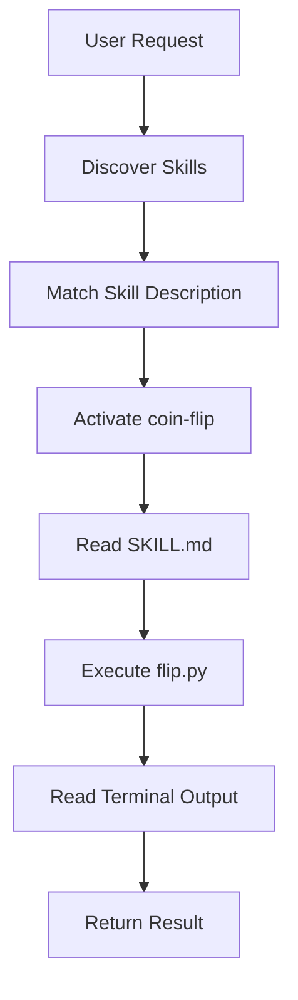

## التطبيق العملي — إنشاء أول Agent Skill

سنقوم بإنشاء مهارة بسيطة تسمى `coin-flip`، تتيح للوكيل
محاكاة رمي قطعة نقدية باستخدام Python وإرجاع نتيجة عشوائية.

### 1. إنشاء بنية المشروع

افتح مشروعك في VS Code، ثم أنشئ البنية التالية:

```text
my-project/
├── .agents/
│   └── skills/
│       └── coin-flip/
│           ├── SKILL.md
│           └── scripts/
│               └── flip.py
└── README.md
```

يُستخدم المسار `.agents/skills/` لتعريف المهارات الخاصة
بالمشروع في Codex.

### 2. إنشاء المجلدات والملفات

افتح Terminal داخل VS Code ونفّذ الأوامر التالية
باستخدام PowerShell:

```powershell
mkdir -Force .agents/skills/coin-flip/scripts

New-Item .agents/skills/coin-flip/SKILL.md

New-Item .agents/skills/coin-flip/scripts/flip.py
```

### 3. كتابة ملف SKILL.md

يمثل هذا الملف نقطة الدخول الأساسية للمهارة، ويحدد هويتها
ومتى يستخدمها الوكيل وكيفية تنفيذها.

File: `.agents/skills/coin-flip/SKILL.md`

```markdown
---
name: coin-flip
description: Flip a virtual coin and return a random result.
  Use when the user asks to flip or toss a coin.
---

# Coin Flip

## Instructions

1. Execute the Python script `scripts/flip.py`.
2. Read the result from the terminal.
3. Return the result to the user.

## Rules

- Always execute the script.
- Never invent a result.
- Do not modify the script.
- Do not repeat the flip unless requested.
```

### 4. كتابة الكود التنفيذي

File: `.agents/skills/coin-flip/scripts/flip.py`

```python
import random

result = random.choice(["Heads", "Tails"])

print(result)
```

تُستخدم مكتبة `random` المدمجة في Python لتوليد
نتيجة عشوائية، ولا تحتاج إلى تثبيت أي مكتبات إضافية.

### 5. اختبار الكود مباشرة

نفّذ الأمر التالي من المجلد الرئيسي للمشروع:

```powershell
python .agents/skills/coin-flip/scripts/flip.py
```

Expected output:

```text
Heads
```

أو:

```text
Tails
```

### 6. استخدام المهارة داخل Codex

افتح إضافة Codex داخل VS Code، وابدأ جلسة جديدة
ضمن المشروع الحالي.

يمكن استدعاء المهارة بطريقتين:

#### Explicit Invocation

استدعاء المهارة مباشرة باستخدام اسمها:

```text
$coin-flip
```

أو:

```text
Use $coin-flip to flip a coin.
```

#### Implicit Invocation

إرسال طلب طبيعي دون تحديد اسم المهارة:

```text
Flip a coin for me.
```

في هذه الحالة، يستطيع الوكيل اكتشاف المهارة المناسبة
بناءً على حقل `description`، ثم تفعيلها وتنفيذ تعليماتها.

### 7. النتيجة المتوقعة

```text
User:
Flip a coin for me.

Agent:
Running the coin-flip skill...

Result:
Heads
```

### 8. كيف نفّذ الوكيل المهارة؟



| المرحلة | الإجراء |
|---|---|
| Discovery | اكتشاف اسم المهارة ووصفها. |
| Activation | قراءة التعليمات الموجودة في SKILL.md. |
| Execution | تنفيذ ملف flip.py. |
| Observation | قراءة النتيجة الفعلية من Terminal. |
| Response | تقديم النتيجة للمستخدم. |

### 9. تجربة إضافية

جرّب إرسال الطلبات التالية إلى الوكيل:

```text
Flip a coin.
```

```text
Flip a coin three times.
```

```text
Toss a coin to help me make a decision.
```

```text
Use the coin-flip skill without modifying any files.
```

راقب كيفية اكتشاف المهارة، وتفعيلها، واستخدام
الأدوات التنفيذية، وإرجاع النتائج.

### 10. المفاهيم المستفادة

- Agent Skills
- SKILL.md
- YAML Front Matter
- Skill Discovery
- Skill Activation
- Progressive Disclosure
- Explicit Invocation
- Implicit Invocation
- Script Execution
- Context Engineering

---

## المراجع

- [Agent Skills](https://agentskills.io/)
- [Agent Skills Specification](https://agentskills.io/specification.md)
- [OpenAI Developers](https://developers.openai.com/)
