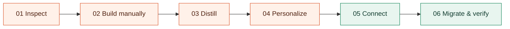
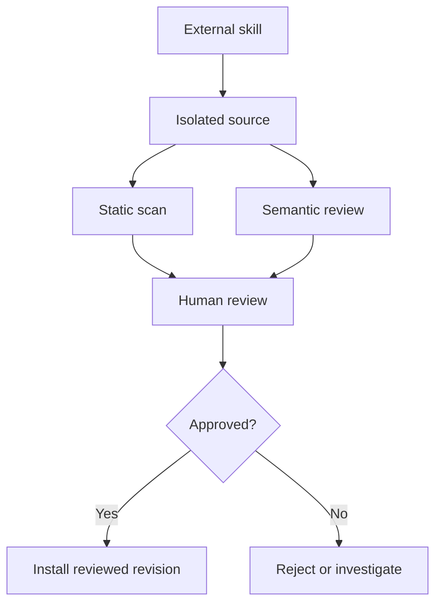
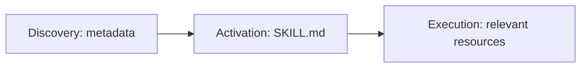
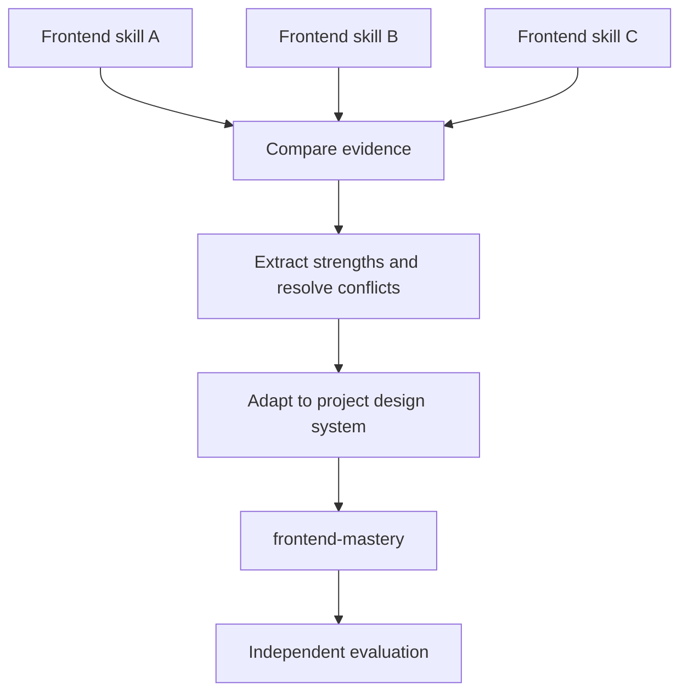
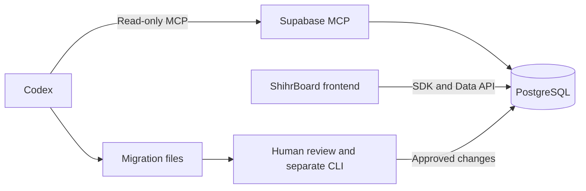
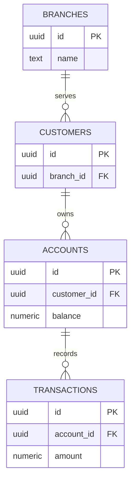
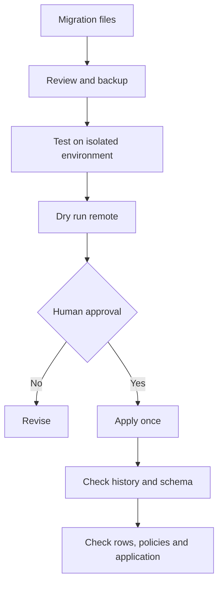

<div align="center">

# AIE2631 · Agentic Harness Engineering

### من هندسة المهارات إلى التكامل الآمن مع قواعد البيانات

**TAWLIID | توليد** · دليل المختبر العملي · نوفمبر 2026

   

**Discover → Inspect → Engineer → Validate → Integrate → Deploy**

</div>

---

## خريطة المختبر

| المسار | المحور | المخرج العملي |
|:--:|:--|:--|
| 01 | [الفحص الأمني للمهارات](#lab-01) | تقرير مخاطر قبل التثبيت |
| 02 | [هندسة المهارات يدويًا](#lab-02) | أول `SKILL.md` |
| 03 | [استخلاص ودمج المهارات](#lab-03) | `frontend-mastery` |
| 04 | [هندسة البصمة الكتابية](#lab-04) | `arabic-writing-style` |
| 05 | [تكامل Supabase والتحكم بالصلاحيات](#lab-05) | اتصال آمن وتطبيق متصل بالبيانات |
| 06 | [تنفيذ الترحيلات والتحقق منها](#lab-06) | قاعدة بيانات موثقة وقابلة للتحقق |

> [!NOTE]
> هذا دليل تطبيقي لمشروع **ShihrBoard**، وهو نموذج لوحة تحكم مالية. الأمثلة والبيانات اصطناعية، ولا تُعد نتائج تنفيذ فعلية. بيئة الأوامر Windows PowerShell داخل VS Code، مع Codex وGit وNode.js وuv. نفّذ عمليات الكتابة على مشروع تطوير معزول فقط.



### قبل البدء

```powershell
git --version
node --version
npm --version
uv --version
codex --version
```

> إذا كنت تستخدم إضافة Codex فقط، فقد لا يتوفر أمر `codex` في الطرفية. ثبّت CLI عند الحاجة وفق [وثائق Codex](https://developers.openai.com/codex/). افتح جذر المشروع قبل تنفيذ الأوامر.

---

<a id="lab-01"></a>
## 01 · الفحص الأمني للمهارات الخارجية

**Skill Security Inspection — Scan before you install**

المهارة الخارجية ليست مجرد نص؛ قد تحتوي على تعليمات وسكربتات ومراجع قادرة على التأثير في سلوك الوكيل. لذلك نفصل بين تنزيل المصدر للفحص وبين تثبيته في مسار المهارات أو تنفيذ محتواه.

### 1. تثبيت NVIDIA SkillSpector

```powershell
uv tool install --python 3.13 git+https://github.com/NVIDIA/SkillSpector.git
skillspector --help
skillspector scan --help
```

للتكرار في بيئة مؤسسية، ثبّت إصدارًا أو commit موثوقًا بعد مراجعته بدل الاعتماد الدائم على الفرع الرئيسي.

### 2. الفحص من GitHub أو skills.sh دون تثبيت المهارة

مثال رابط: `https://skills.sh/vercel-labs/agent-skills/web-design-guidelines`.

المستودع هو `vercel-labs/agent-skills` والمهارة هي `web-design-guidelines`. نزّل المستودع في مجلد مؤقت خارج المشروع، ثم حدد مكان المهارة الفعلي:

```powershell
$review = Join-Path $env:TEMP ("skill-review-" + [guid]::NewGuid())
git clone --depth 1 https://github.com/vercel-labs/agent-skills.git $review
Get-ChildItem $review -Recurse -Filter SKILL.md
```

بعد التأكد من المسار، استبدل القيمة التالية بالمجلد الذي يحتوي على `SKILL.md`:

```powershell
$target = "PATH_TO_SKILL_FOLDER"
skillspector scan "$target" --no-llm
skillspector scan "$target" --no-llm --format json --output "$review\report.json"
```

الطريقة نفسها تعمل مع رابط GitHub مباشر: استخرج المستودع ثم حدد مجلد المهارة. لا تشغّل سكربتاتها ولا تثبت تبعياتها أثناء الفحص. `--no-llm` يستبعد التحليل المعتمد على نموذج لغوي؛ لا يعني أن الفحص يغطي جميع المخاطر.

### 3. الفحص من Codex باستخدام Skill Inspector

راجع أولًا [مصدر Skill Inspector](https://github.com/NVIDIA/SkillSpector/tree/main/skills/skill-inspector) وأمانه، ثم ثبّته إذا اعتمدته:

```powershell
npx skills add NVIDIA/SkillSpector --skill skill-inspector --agent codex
```

يمكن إعادة تحميل جلسة Codex إذا لم تظهر المهارة.

<details open>
<summary><b>Prompt 01 — فحص مهارة قبل تثبيتها</b></summary>

```text
Use $skill-inspector to audit the following skill before installation:
[PASTE GITHUB OR SKILLS.SH URL]
Resolve its source and download it into an isolated temporary directory.
Run NVIDIA SkillSpector with --no-llm and review SKILL.md, scripts,
dependencies, permissions, external connections, prompt injection,
data exfiltration and supply-chain risks. Report findings, severity,
file/line evidence and a final verdict: APPROVE, CAUTION or REJECT.
Do not install the target skill, execute its scripts or install its
dependencies. Require my explicit approval before installation.
```
</details>

| مجال الفحص | السؤال الحاكم |
|---|---|
| Prompt Injection | هل تحاول التعليمات تجاوز حدود المهمة؟ |
| Data Exfiltration | هل تنقل بيانات أو أسرارًا إلى جهة غير معتمدة؟ |
| Permissions | هل تطلب صلاحيات تتجاوز حاجتها؟ |
| Supply Chain | هل المصادر والتبعيات موثوقة ومحددة؟ |
| Code Security | هل توجد عمليات تنفيذ أو حذف أو اتصال غير مبررة؟ |



- [ ] فحص المصدر قبل تثبيته، ومراجعة الترخيص والتبعيات.
- [ ] حفظ التقرير وربطه بالإصدار الذي فُحص.
- [ ] مراجعة النتائج وعدم اعتبار غياب التحذيرات ضمانًا للأمان.

**المراجع:** [NVIDIA SkillSpector](https://github.com/NVIDIA/SkillSpector) · [دليل NVIDIA للفحص](https://docs.nvidia.com/skills/scanning-agent-skills) · [Skills.sh](https://skills.sh/)

[↑ العودة إلى الفهرس](#خريطة-المختبر)

---

<a id="lab-02"></a>
## 02 · إنشاء مهارة مخصصة يدويًا

**Manual Skill Engineering — From prompts to reusable knowledge**

الهدف فهم المعيار وبنية المهارة من خلال التعلم الذاتي الموجّه، لا الاعتماد على مولّد المهارات في كل مرة.

| الترتيب | المرجع | المطلوب |
|:--:|---|---|
| 1 | [Agent Skills Overview](https://agentskills.io/home) | فهم المهارة وآلية استخدامها |
| 2 | [Agent Skills Specification](https://agentskills.io/specification) | قراءة متطلبات البنية والبيانات الوصفية |
| 3 | [Hugging Face — Context Course, Unit 1](https://huggingface.co/learn/context-course/en/unit1/introduction) | دراسة هندسة السياق، صيغة SKILL.md، بناء أول مهارة، والاختبارات الواردة في الوحدة |

### التطبيق: مهارة مراجعة لوحة التحكم

أنشئ في VS Code المجلد والملف يدويًا:

```text
.agents/
└── skills/
    └── dashboard-review/
        └── SKILL.md
```

ضع فيه المثال التالي (بالإنجليزية ليسهل التحقق من البنية):

```markdown
---
name: dashboard-review
description: Review dashboard interfaces for responsive layout, RTL,
  accessibility, and readable financial indicators. Use when asked
  to audit or review a dashboard UI.
---

# Dashboard Review

## Workflow
1. Inspect the existing dashboard and its design constraints.
2. Review mobile layout, RTL, contrast, and keyboard navigation.
3. Check financial labels, units, and empty/loading/error states.
4. Report findings ordered by severity with concrete evidence.

## Constraints
- Do not modify files unless explicitly requested.
- Do not invent test results.

## Output
Return a concise report with finding, evidence, and recommendation.
```

في Codex استخدم `$dashboard-review` واطلب مراجعة لوحة ShihrBoard. اختبر الاستدعاء الصريح ثم طلبًا طبيعيًا يتوافق مع وصف المهارة. اختبر كذلك طلبًا غير مرتبط للتأكد من عدم تفعيلها بلا داعٍ.



هذه هي فكرة **Progressive Disclosure**: اكتشاف المهارة عبر الوصف أولًا، ثم تحميل تعليماتها وملفاتها المساندة عند الحاجة. المجلدات `references/` و`scripts/` و`assets/` اختيارية.

- [ ] اسم المهارة يطابق اسم المجلد، والوصف يحدد متى تُستخدم.
- [ ] التعليمات قابلة للتنفيذ، والمخرجات واضحة.
- [ ] اختبار التفعيل وعدم التفعيل، وتسجيل النتيجة.

**مرجع إضافي:** [OpenAI — Build skills](https://developers.openai.com/plugins/build/skills)

---

<a id="lab-03"></a>
## 03 · استخلاص ودمج المهارات الخارجية

**Skill Distillation & Composition**

بعد تجربة ثلاث مهارات خارجية لتصميم الواجهات، يمكن تحويل نقاط قوتها إلى مهارة مستقلة خاصة بالمشروع. لا ندمج النصوص آليًا؛ نحدد القدرات، نعالج التعارض، ونحذف التكرار، ونحافظ على التراخيص.



<details open>
<summary><b>Prompt 02 — هندسة مهارة مركبة باستخدام Skill Creator</b></summary>

```text
استخدم $skill-creator لتحليل مهارات Frontend Design الثلاث التي استخدمناها
في هذا المشروع: [أسماء المهارات أو مساراتها]. حدّد نقاط القوة والقدرات
الفريدة لكل مهارة، واستخلص أفضل الممارسات والتعليمات وأنماط التصميم،
وأزل التكرار والتعارضات والتعليمات غير الضرورية. راجع القرارات التصميمية
الناجحة المثبتة في المشروع، ثم ادمج المعرفة في مهارة مستقلة باسم
frontend-mastery تتوافق مع هوية المشروع وتقنياته، مع التركيز على UI/UX،
Design System، Responsive Design، RTL، Accessibility وجودة الكود.
راجع تراخيص المصادر وأمانها وحافظ على حقوقها، وطبّق Progressive Disclosure.
أنشئ المهارة في .agents/skills/frontend-mastery/SKILL.md وفق Agent Skills
Specification، وأضف المراجع عند الحاجة فقط. تحقّق من البنية وقابلية إعادة
الاستخدام دون تعديل الكود الحالي أو المهارات الأصلية. إذا تعذر الوصول إلى
أي مصدر، اذكر ذلك ولا تخمّن محتواه.
```
</details>

### البنية المقترحة

```text
.agents/skills/frontend-mastery/
├── SKILL.md
└── references/            # عند الحاجة فقط
    ├── design-system.md
    └── source-notes.md
```

وثّق المصدر والإصدار والترخيص والقدرة المستخلصة وسبب اعتمادها أو استبعادها. لا تعتمد على ذاكرة جلسات سابقة إذا لم تكن ملفات المهارات متاحة.

<details>
<summary><b>Prompt 03 — اختبار المهارة الجديدة</b></summary>

```text
استخدم $frontend-mastery لتصميم وتطوير لوحة تحكم مالية حديثة باللغة
العربية، تدعم RTL وResponsive Design، وتلتزم بالهوية البصرية للمشروع
ومعايير UI/UX وإمكانية الوصول، دون استدعاء المهارات الثلاث الأصلية.
اعرض أدلة التحقق من المعايير، ولا تعدّل ملفات غير مرتبطة بالمهمة.
```
</details>

| معيار المقارنة | قبل الدمج | بعد الدمج |
|---|---|---|
| اتساق الهوية | قياس فعلي | قياس فعلي |
| جودة RTL والاستجابة | قياس فعلي | قياس فعلي |
| عدد مخالفات الوصول | قياس فعلي | قياس فعلي |
| استهلاك السياق | قياس فعلي | قياس فعلي |

> [!IMPORTANT]
> هذا استخلاص على مستوى التعليمات والمعرفة، لا Model Distillation ولا Fine-tuning. لا نفترض أن تقليل عدد المهارات يؤدي تلقائيًا إلى تقليل استهلاك Tokens. اختبر المهارة في جلسة أو بيئة لا تتيح المهارات الأصلية مع توحيد شروط المقارنة.

---

<a id="lab-04"></a>
## 04 · هندسة مهارة البصمة الكتابية الشخصية

**Personal Writing Style Skill**

الهدف تحويل نمط الكتابة إلى تعليمات قابلة لإعادة الاستخدام، دون نسخ العبارات أو افتراض خصائص لا تدعمها العينة.

<details open>
<summary><b>Prompt 04 — إنشاء مهارة البصمة الكتابية</b></summary>

```text
Use $skill-creator to analyze the reference article below and create
 a reusable custom skill named arabic-writing-style that captures my
 personal writing style, tone, voice, vocabulary, sentence structure,
 paragraph organization, narrative flow, argumentation, Arabic grammar,
 spelling, punctuation, and integration of English technical terminology.
 Extract explicit and implicit patterns, stylistic preferences, recurring
 expressions, quality criteria and anti-patterns. Preserve my natural voice
 without copying sentences or inventing unsupported characteristics.
 Create .agents/skills/arabic-writing-style/SKILL.md following the Agent
 Skills specification. Apply Progressive Disclosure and add references
 only when necessary. Validate it on a different topic and compare the
 output with the reference.

Reference article:
[DEMO ARTICLE]
```
</details>

```text
.agents/skills/arabic-writing-style/
├── SKILL.md
└── references/            # اختياري
    ├── style-guide.md
    └── sample-article.md
```

| البعد | معيار المراجعة |
|---|---|
| Voice & Tone | هل حافظ على نبرة الكاتب ومستوى لغته؟ |
| Structure | هل تسلسل الفقرات والحجج طبيعي؟ |
| Arabic Rules | هل الإملاء والنحو والترقيم منضبطة؟ |
| Terminology | هل توظيف المصطلحات الإنجليزية ملائم؟ |
| Originality | هل تجنب نسخ الجمل والعبارات الآلية؟ |

<details>
<summary><b>Prompt 05 — اختبار البصمة الكتابية</b></summary>

```text
استخدم $arabic-writing-style لكتابة مقال حول الانتقال من Prompt Engineering
إلى Agentic Harness Engineering، مع الالتزام ببصمتي الكتابية ونبرة الطرح
والبنية اللغوية، دون نسخ عبارات المقال المرجعي أو استخدام تعبيرات نمطية.
```
</details>

يفضل استخدام عدة مقالات متنوعة للتمييز بين خصائص الكاتب وخصائص الموضوع. استخدم مقالات تملك حق استعمالها، واحذف المعلومات الحساسة قبل تضمينها في مستودع مشترك. المقال هنا عنصر نائب يقدمه المتدرب؛ لم يُحلل مقال فعلي في هذا الدليل.

---

<a id="lab-05"></a>
## 05 · تكامل Supabase وضبط صلاحيات الوكيل

**MCP Integration · Data API · Deterministic Access Control**

تثبيت إضافة Supabase في VS Code لا يعني أن Codex أصبح متصلًا بقاعدة البيانات، ولا أن التطبيق أصبح قادرًا على استخدامها. لكل طبقة وظيفة مستقلة.



### 1. إعداد المشروع

أنشئ مشروع تطوير في [Supabase Dashboard](https://supabase.com/dashboard) باسم `shihrboard-dev` أو اسمك المختار. احصل على Project Reference ID وProject URL وPublishable Key من إعدادات الاتصال. لا تشارك كلمة مرور قاعدة البيانات أو مفاتيح Secret/Service Role داخل المحادثة أو المستودع.

### 2. ربط Codex عبر MCP

من CLI (بعد تثبيته عند الحاجة):

```powershell
codex mcp add supabase --url "https://mcp.supabase.com/mcp?project_ref=YOUR_PROJECT_REF&read_only=true"
codex mcp login supabase
codex mcp list
```

أو اضبط ملف `~/.codex/config.toml`، الذي يوجد عادة تحت `$HOME\.codex\config.toml` في Windows:

```toml
[mcp_servers.supabase]
url = "https://mcp.supabase.com/mcp?project_ref=YOUR_PROJECT_REF&read_only=true"
```

أكمل OAuth في المتصفح، وأعد تحميل الجلسة عند الحاجة. استخدم طريقة إعداد واحدة، ولا تكرر تعريف الخادم.

<details open>
<summary><b>Prompt 06 — اختبار الاتصال</b></summary>

```text
استخدم Supabase MCP للتحقق من الاتصال بالمشروع، واعرض معرف المشروع
والمخططات والجداول الحالية والأدوات المتاحة، دون تعديل قاعدة البيانات.
```
</details>

### 3. تصميم قاعدة البيانات انطلاقًا من التطبيق

<details open>
<summary><b>Prompt 07 — تصميم المخطط والبيانات الاصطناعية</b></summary>

```text
حلّل مشروع ShihrBoard الحالي والواجهات والمؤشرات المالية والبيانات
التجريبية. صمّم Database Schema تتوافق مع احتياجاته، وحدّد الجداول
والعلاقات وأنواع البيانات والمفاتيح والفهارس. افحص قاعدة البيانات الحالية
عبر MCP للقراءة فقط. اعرض الخطة ثم أنشئ ملفات SQL Migrations وSeed Data
اصطناعية للمراجعة البشرية، مع RLS وسياسات الوصول المناسبة، دون تنفيذها
أو حذف بيانات موجودة أو تغيير التصميم الحالي. وثّق أسماء المخططات
وما يحتاج التطبيق إلى الوصول إليه من Data API.
```
</details>

مثال تصوري فقط، وليس وصفًا للمخطط الفعلي:



### 4. ربط التطبيق بقاعدة البيانات

المثال التالي يفترض React + Vite. إن كان المشروع يستخدم إطارًا آخر، اطلب من Codex تكييف SDK وطريقة البيئة معه.

```powershell
npm install @supabase/supabase-js
```

`.env.local`:

```dotenv
VITE_SUPABASE_URL=https://YOUR_PROJECT_REF.supabase.co
VITE_SUPABASE_PUBLISHABLE_KEY=YOUR_PUBLISHABLE_KEY
```

`src/lib/supabase.ts`:

```typescript
import { createClient } from '@supabase/supabase-js'

export const supabase = createClient(
  import.meta.env.VITE_SUPABASE_URL,
  import.meta.env.VITE_SUPABASE_PUBLISHABLE_KEY
)
```

احفظ lockfile، واستبعد ملفات البيئة الخاصة من Git، وشارك `.env.example` بقيم فارغة. متغيرات `VITE_` متاحة للمتصفح؛ لا تضع فيها مفاتيح سرية. المفتاح القابل للنشر لا يغني عن سياسات الوصول.

<details>
<summary><b>Prompt 08 — ربط الواجهة بالبيانات</b></summary>

```text
اربط ShihrBoard بـ Supabase باستخدام SDK الرسمي المناسب. استبدل Mock Data
بالبيانات الفعلية، واضبط Environment Variables وطبقة Data Access، واربط
الجداول والمؤشرات والرسوم البيانية، وعالج Loading وError وEmpty State.
حافظ على الهوية الحالية ولا تكشف مفاتيح سرية أو تعطّل RLS.
```
</details>

### 5. هل Project Reference ID سر؟ وهل التفويض آمن؟

| العنصر | القاعدة |
|---|---|
| Project Reference / URL | معرف وليس سرًا؛ لا يمنح الوصول بمفرده |
| Publishable Key | للاستخدام المقصود في العميل مع RLS |
| Password / Secret / Service Role / PAT | أسرار؛ لا تُدرج في المحادثات أو ملفات الواجهة |
| OAuth | يحدد الهوية والتفويض؛ راجع النطاق والمشروع |

### 6. منع الكتابة دون موافقة بشرية حقيقية

| الآلية | جهة الإنفاذ | الحد |
|---|---|---|
| AGENTS.md | تعليمات الوكيل | ليست حدًا أمنيًا |
| Client approval | عميل MCP / Codex | لا يحمي من مسارات أخرى |
| `read_only=true` | خادم MCP | يقيد الاتصال المحدد فقط |
| Scoped credential | Supabase / نظام التفويض | يعتمد على الصلاحيات الفعلية |
| PostgreSQL GRANT / REVOKE | قاعدة البيانات | يعتمد على الدور الفعلي ووراثة الصلاحيات |
| RLS | قاعدة البيانات | يحدد الوصول للصفوف ولا يقيد كل الأدوار المميزة |
| Approval Gateway | طبقة تنفيذ موثوقة | موافقة مرتبطة بعملية محددة |

> [!CAUTION]
> لا يوجد ضمان للموافقة البشرية على كل عملية كتابة بمجرد منح MCP صلاحية كتابة. أبقِ Codex على القراءة فقط، واستخدم حسابًا أو اعتمادًا محدود النطاق لا يملك الكتابة إذا كان مدعومًا لمسار الاتصال. احفظ صلاحيات CLI والكتابة في بيئة مستقلة عن الوكيل، بما فيها جلسة المتصفح الإدارية. لا يكفي تغيير رابط MCP إن أمكن للوكيل إعادة التفويض بصلاحيات أوسع.

مثال دور PostgreSQL مستقل (للتوضيح، يُنفَّذ فقط بعد مراجعة مسؤول قاعدة البيانات):

```sql
CREATE ROLE codex_readonly NOLOGIN;
GRANT USAGE ON SCHEMA public TO codex_readonly;
GRANT SELECT ON ALL TABLES IN SCHEMA public TO codex_readonly;
REVOKE INSERT, UPDATE, DELETE, TRUNCATE
ON ALL TABLES IN SCHEMA public FROM codex_readonly;
REVOKE CREATE ON SCHEMA public FROM codex_readonly;
```

هذا المثال لا يغيّر هوية MCP الرسمي تلقائيًا. يتطلب هوية اتصال مخصصة ترث الدور، وفحص صلاحيات PUBLIC والأدوار الموروثة وملكية الكائنات والدوال وRLS والجداول المستقبلية. لا تستخدم حساب postgres أو service_role للوكيل بهدف فرض هذه القيود.

للتحكم في كل عملية كتابة آليًا، يمكن بناء بوابة موافقة مستقلة تحتفظ بالاعتماد المميز، وتربط موافقة المستخدم بالمحتوى الدقيق للعملية والهدف والمدة، وتمنع إعادة الاستخدام وتوثق التنفيذ. الخيار الأبسط للمختبر هو توليد SQL ثم مراجعته وتنفيذه يدويًا في بيئة إدارية مستقلة.

<details>
<summary><b>قواعد مساندة داخل AGENTS.md — ليست بديلًا عن الصلاحيات</b></summary>

```markdown
## Database Security Rules
- Access only the authorized development project.
- Generate migrations for review; do not execute remote writes.
- Never delete, truncate, or disable RLS without explicit authorization.
- Use synthetic data and never expose secrets.
- Report proposed changes, risks, validation and rollback strategy.
```
</details>

### 7. التحقق من التكامل

<details>
<summary><b>Prompt 09 — End-to-End Validation</b></summary>

```text
تحقق من الاتصال والجداول والعلاقات وصحة البيانات والمؤشرات وسياسات RLS
وصلاحيات المستخدمين، وافحص Security Advisors وPerformance Advisors
والسجلات المتاحة. اختبر التطبيق فعليًا وسجّل الأدلة. اختبر عمليات CRUD
على بيئة اختبار محلية معزولة فقط، واقترح اختبارات الكتابة البعيدة للمراجعة
البشرية. لا تعدّل قاعدة البيانات السحابية أو تعطّل ضوابط الأمان.
```
</details>

- [ ] الاتصال يطابق Project Reference المطلوب.
- [ ] جداول ومخططات البيانات تطابق احتياجات التطبيق.
- [ ] Data API وGRANT وRLS متوافقة مع الأدوار المصرح بها.
- [ ] اختبار القراءة المسموح بها والكتابة المرفوضة لهوية الوكيل في بيئة اختبار.
- [ ] التطبيق يبنى بنجاح والمؤشرات تطابق بيانات الاختبار.

**المراجع:** [Supabase MCP](https://supabase.com/docs/guides/ai-tools/mcp) · [Data API security](https://supabase.com/docs/guides/api/securing-your-api) · [RLS](https://supabase.com/docs/guides/database/postgres/row-level-security) · [Supabase JS](https://supabase.com/docs/reference/javascript/introduction)

---

<a id="lab-06"></a>
## 06 · مراجعة وتنفيذ ترحيلات قاعدة البيانات

**Secure Database Migrations — Agent-generated, human-reviewed, system-validated**

ملف Migration هو تغيير مُصدّر في ملف SQL؛ وجود الملف لا يثبت تنفيذه، ووجوده في سجل الترحيلات لا يثبت تحقق جميع المخرجات المتوقعة.

### 1. بنية المشروع

```text
ShihrBoard/
├── .agents/skills/
├── AGENTS.md
├── src/
├── .env.example
└── supabase/
    ├── config.toml          # أو config.jsonc في المشاريع الجديدة
    ├── migrations/
    │   ├── 20261126131156_shihr_schema.sql
    │   ├── 20261126131210_shihr_workflow.sql
    │   └── 20261126134722_shihr_data_api.sql
    └── seed.sql             # عند وجوده
```

أسماء الترحيلات أعلاه مأخوذة من سجل الحالة التدريبية، أما وجود هذه الملفات محليًا وملف seed فبحاجة للتحقق. منذ CLI v3.4.0 ينشئ `supabase init` للمشروعات الجديدة `config.jsonc`؛ المشروعات القائمة قد تستخدم `config.toml`.

### 2. تجهيز CLI وتحديد المشروع

نفّذ أوامر الإدارة من طرفية بشرية لا يستطيع الوكيل الوصول إلى اعتمادها.

```powershell
npx supabase --version
npx supabase db push --help
npx supabase migration list --help
Get-ChildItem .\supabase -Recurse -Filter *.sql
npx supabase login
npx supabase projects list
npx supabase link --project-ref YOUR_PROJECT_REF
```

يمكن تثبيت CLI في المشروع باستخدام `npm install supabase --save-dev` مع تثبيت الإصدار في lockfile. إذا لم يكن مجلد الإعداد موجودًا أصلًا استخدم `npx supabase init` بعد التحقق من جذر المشروع.

> [!IMPORTANT]
> منذ CLI v3 أصبحت العمليات التي تدعم البيئة المحلية تستهدفها افتراضيًا. استخدم `--remote` صراحة للبيئة المستضافة. في v2 استخدم `--linked` إن كان مدعومًا حسب `--help`. لا تخلط أوامر الإصدارات دون مراجعة.

### 3. مراجعة سجل الترحيلات والمعاينة

**CLI v3:**

```powershell
npx supabase migration list --remote
npx supabase db push --dry-run --remote
```

**CLI v2:**

```powershell
npx supabase migration list --linked
npx supabase db push --linked --dry-run
```

| Local | Remote | التشخيص |
|---|---|---|
| موجود | مطابق | الترحيل مسجل كتغيير مطبق |
| موجود | فارغ | ترحيل معلق |
| فارغ | موجود | ملف محلي مفقود أو عدم اتساق |

المعاينة تعرض التغييرات المعلقة ولا تختبر سلامة كل عبارة SQL. راجع `DROP` و`TRUNCATE` و`DELETE` و`UPDATE` و`ALTER` وGRANT وسياسات RLS والدوال المميزة؛ تحقق من نطاق الصفوف والقيود والتبعيات. جهّز نسخة احتياطية قابلة للاستعادة واختبر التغييرات محليًا أو في بيئة staging قبل التنفيذ. لا تفترض توفر rollback تلقائي.

<details>
<summary><b>Prompt 10 — مراجعة ملفات SQL قبل اعتمادها</b></summary>

```text
راجع SQL Migrations وترتيبها وتوافقها مع قاعدة البيانات الحالية. افحص
العمليات التخريبية وRLS والصلاحيات والعلاقات والبيانات. قدّم تقريرًا
بالمخاطر والتغييرات المتوقعة وخطة الاختبار والتراجع وأوامر Dry Run
والتنفيذ اليدوي والتحقق، دون تطبيق أي Migration أو تعديل قاعدة البيانات.
```
</details>

### 4. التنفيذ البشري بعد الموافقة

```powershell
# CLI v3
npx supabase db push --remote
npx supabase migration list --remote
```

```powershell
# CLI v2
npx supabase db push --linked
npx supabase migration list --linked
```

راجع المشروع المستهدف وملفات الترحيل، ثم وافق بنفسك على التنفيذ. لا تستخدم `--yes` لتجاوز الموافقة. إذا تغيّر الملف بعد المراجعة، أعد مراجعته.

### 5. إدراج Dataset الاصطناعية

قد تكون البيانات ضمن Migration أو `seed.sql` أو ملفات Seed محددة في الإعداد. إذا كانت منفصلة، راجع احتمال التكرار وأي آثار تخريبية ثم عاين ونفّذ عند الحاجة فقط:

```powershell
# CLI v3
npx supabase db push --remote --include-seed --dry-run
npx supabase db push --remote --include-seed
```

في CLI v2 استبدل `--remote` بـ `--linked` إن كان متاحًا. لا تعد إدراج البيانات لمجرد عدم ظهورها في Table Editor؛ تحقق أولًا من المخطط وعدد الصفوف.

### 6. البديل: SQL Editor في Supabase Dashboard

افتح المشروع الصحيح ثم SQL Editor → New Query. راجع SQL وانسخه ونفذه يدويًا، ثم تحقق من النتائج. **لا تنفذ ملف الترحيل ذاته عبر CLI وDashboard معًا**؛ تنفيذ SQL مباشرة لا يسجل بالضرورة الترحيل في سجل CLI، وقد يسبب عدم اتساق لاحقًا.

| البعد | CLI | SQL Editor |
|---|---|---|
| إدارة تاريخ الترحيلات | مدمجة | ليست تلقائية عند تنفيذ SQL يدويًا |
| معاينة pending migrations | متاحة | لا يوجد نظير مباشر |
| قابلية التكرار والمراجعة عبر Git | مرتفعة | تحتاج إجراءً يدويًا |
| الموافقة البشرية | تنفيذ بشري مستقل | ضغط Run من المسؤول |

التوصية للمختبر: CLI مع مراجعة بشرية وصلاحيات معزولة؛ كلا المسارين يمكن أن ينفذ SQL تخريبيًا إن أُسيء استخدامه.

### 7. دراسة حالة: سجل الترحيلات موجود ولكن public فارغ

في الحالة التدريبية ظهرت ثلاثة ترحيلات في لوحة Supabase: `shihr_schema` و`shihr_workflow` و`shihr_data_api`، بينما أعاد الاستعلام التالي صفر سجلات:

```sql
SELECT table_schema, table_name
FROM information_schema.tables
WHERE table_schema = 'public'
  AND table_type = 'BASE TABLE'
ORDER BY table_name;
```

هذا لا يثبت غياب الجداول من قاعدة البيانات؛ الاستعلام يقتصر على `public` وعلى الجداول الأساسية. ابدأ بفحص جميع المخططات:

```sql
SELECT schema_name
FROM information_schema.schemata
ORDER BY schema_name;
```

```sql
SELECT table_schema, table_name, table_type
FROM information_schema.tables
WHERE table_schema NOT IN ('pg_catalog', 'information_schema')
ORDER BY table_schema, table_name;
```

```sql
SELECT version, name
FROM supabase_migrations.schema_migrations
ORDER BY version DESC;
```

اختر المخطط الصحيح من القائمة في Table Editor. افتح **View migration SQL** بجانب `shihr_schema` وابحث عن `CREATE SCHEMA` و`CREATE TABLE` وحدد أسماء الكائنات الفعلية. إذا وجدت جدولًا، تحقق من عدد صفوفه باستعلام مثل الآتي بعد استبدال الأسماء بأسماء صحيحة:

```sql
-- مثال فقط: استبدل الاسمين حسب نتائج الفحص
SELECT count(*) FROM shihr.customers;
```

| النتيجة | الإجراء |
|---|---|
| الجداول في مخطط مخصص | اختر المخطط وتحقق من إعداد SDK وData API |
| الجداول بلا بيانات | افحص Seed Data وسجل التنفيذ |
| Views فقط | تحقق من نوع الكائنات وهدف المخطط |
| سجل موجود دون الكائنات المتوقعة | راجع SQL والسجل والهدف قبل أي إصلاح |
| الجداول موجودة لكن التطبيق لا يقرأها | افحص schema exposure وGRANT وRLS وهوية المستخدم |

إذا كان المخطط مخصصًا، يمكن للعميل استخدام `supabase.schema('actual_schema').from('actual_table')` عند تعريضه عمدًا عبر Data API ومنح الصلاحيات المناسبة. لا تعرّض مخططًا خاصًا لمجرد حل خطأ الواجهة.

<details open>
<summary><b>Prompt 11 — تشخيص الحالة دون كتابة</b></summary>

```text
The migrations shihr_schema, shihr_workflow and shihr_data_api are recorded
in remote migration history, but the public schema query returns no rows.
Inspect local SQL and use read-only Supabase MCP to identify schemas,
tables, views, functions, row counts, seed status, exposed Data API schemas
and permissions. Verify the frontend schema configuration. Report the root
cause with evidence and propose a corrective migration if needed.
Do not write, reset, repair or reapply migrations without my approval.
```
</details>

> [!CAUTION]
> لا تستخدم `db reset --remote` أو `migration repair` أو حذف ملفات الترحيلات كخطوة تشخيص أولى. إعادة الضبط البعيد قد تدمر البيانات؛ إصلاح السجل لا ينفذ SQL. لم تُعرض في هذه الحالة نتائج الاستعلام الموسع، ولذلك يبقى احتمال المخطط المخصص فرضية تحتاج إثباتًا.



**المراجع:** [Database migrations](https://supabase.com/docs/guides/deployment/database-migrations) · [CLI reference](https://supabase.com/docs/reference/cli/introduction) · [CLI v3 migration guide](https://supabase.com/docs/guides/local-development/cli/migrating-to-v3) · [Local and hosted projects](https://supabase.com/docs/guides/local-development/local-and-hosted-projects) · [Supabase Changelog](https://supabase.com/changelog.md)

---

## بوابة التقييم النهائي · Lab Exit Criteria

| المحور | الدليل الذي يقدمه المتدرب |
|---|---|
| 01 | تقرير الفحص وقرار الاعتماد أو الرفض |
| 02 | ملف SKILL.md مكتوب يدويًا واختبار تفعيله |
| 03 | مهارة مركبة وتوثيق المصادر ومقارنة المخرجات |
| 04 | مهارة كتابة وعينة اختبار مستقلة |
| 05 | إثبات اتصال MCP محدود وقراءة التطبيق ورفض كتابة الوكيل |
| 06 | سجل ترحيلات ونتيجة معاينة وتحقق من المخططات والبيانات |

- [ ] لم تُرفع أسرار أو بيانات مالية حقيقية إلى المستودع.
- [ ] لم يُمنح الوكيل مسارًا بديلًا غير مقيد للكتابة.
- [ ] كل نتيجة اختبار موثقة بدليل، وكل إخفاق مسجل بوضوح.
- [ ] التغييرات المعتمدة فقط موجودة في Git وسجل الترحيلات.

---

<div align="center">

**TAWLIID | توليد** · AIE2631

**امنح الوكيل القدرة على العمل، لا سلطة غير مقيدة على التنفيذ.**

Scan before installation · Engineer for reuse · Authorize before execution

</div>
