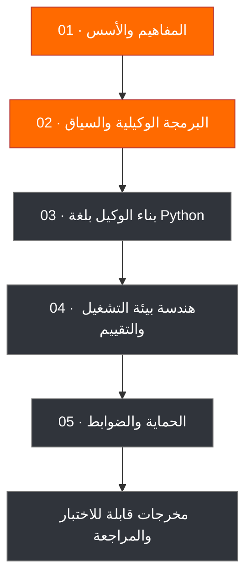
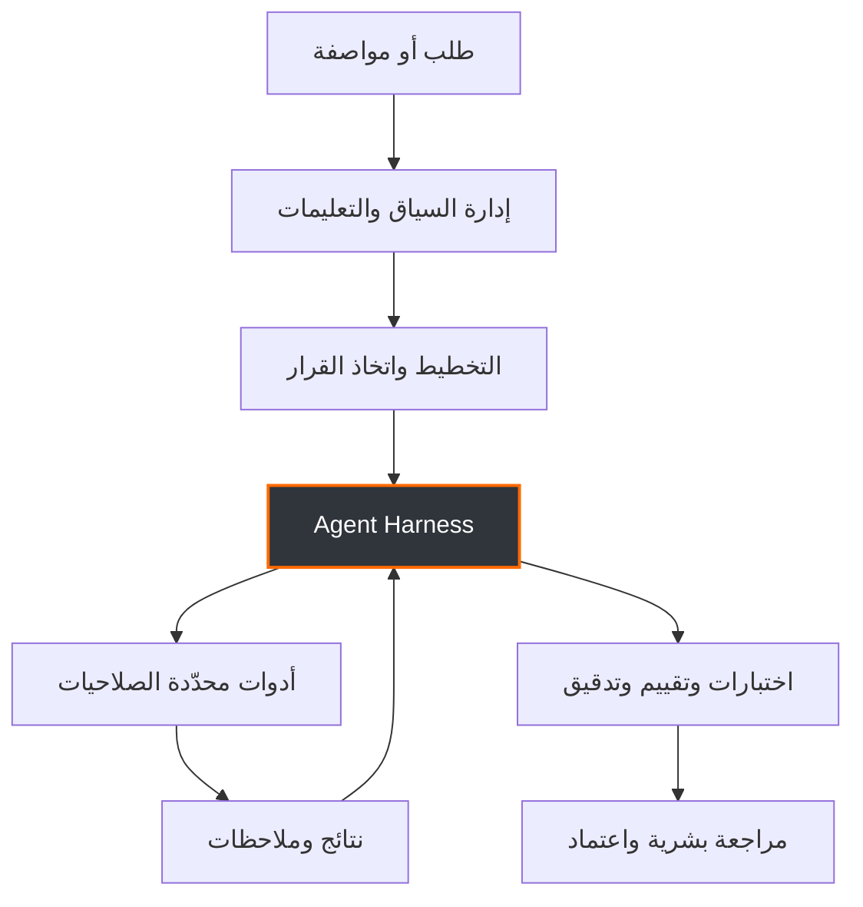
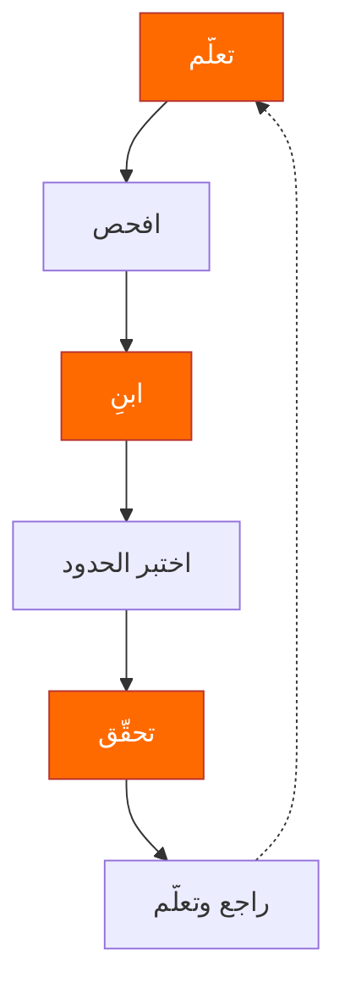

<div align="center" dir="rtl">

# الهندسة الوكيلية الذكية

### Agentic Harness Engineering

**AIE2631 | برنامج هندسي تطبيقي مكثف (30 ساعة)**

<p>
  
  
  
  
</p>

<p>
  
  
  
  
</p>

> **من فهم الوكيل إلى هندسة بيئة تشغيله:** تعليمات مضبوطة، وأدوات مقيّدة الصلاحيات، ومسارات تنفيذ قابلة للاختبار، وأثر يمكن تتبّعه ومراجعته.

**[خارطة التعلّم](#-خارطة-التعلّم) · [منهجية التدريب](#-منهجية-التدريب) · [البدء السريع](#-البدء-السريع) · [حالة المحتوى](#-حالة-المحتوى)**

</div>

---

<div dir="rtl" align="right">

## ◈ عن البرنامج

**هندسة بيئات تشغيل الوكلاء الذكيّة** برنامج تطبيقي موجّه للمطوّرين والمهندسين الراغبين في الانتقال من الاستعانة بمساعدات البرمجة إلى **تصميم أنظمة وكيلية منضبطة وقابلة للتحقّق**. تتدرّج الرحلة من المفاهيم والمصطلحات الأساسية، مرورا بهندسة السياق والبرمجة الوكيلية وبروتوكولات ربط الأدوات، وصولًا إلى بناء وكيل بلغة Python، وتطوير بيئة تشغيله وتأمين حدوده.

يضم المستودع مساحة عمل موحدة باسم **`AIE2631/`**، تتفرع عنها خمس وحدات مترابطة. يجمع الأسلوب بين الشرح العربي الرصين والمصطلحات الهندسية الإنجليزية المعيارية؛ لتظل المعرفة قابلة للنقل إلى التوثيق والأدوات المهنية.

> [!IMPORTANT]
> **الإصدار الحالي تدريجي:** تتوافر المواد الأساسية للوحدتين الأولى والثانية. ستضاف الوحدات الثالثة والرابعة والخامسة، والمشروع الختامي، بحسب الجدول التنفيذي للدورة. لا تعدّ العناصر الموسومة «قريبًا» منشورةً أو مكتملة حاليا.

## 🧭 خارطة التعلّم

| الوحدة | المسار | المدة | المحاور التطبيقية | المخرج المستهدف | الحالة |
|:---:|---|:---:|---|---|:---:|
| **01** | [الأسس والمصطلحات الوكيلية](AIE2631/module-01-foundations/README.md) | 4 ساعات | النماذج، سير العمل، الوكلاء، الـHarness، الحلقات، الرسوم البيانية، السياق والتقييم | قرار معماري مدعوم بالمبرّرات واختبار مصطلحات | 🟢 متاحة |
| **02** | [البرمجة الوكيلية وعقود السياق](AIE2631/module-02-agentic-coding/README.md) | 4 ساعات | `AGENTS.md`، و`SKILL.md`، و`MCP`، وتعريف الأدوات، والمواصفات القابلة للتحقّق | مواصفة تنفيذية ومراجعة التعليمات والمهارات والأدوات | 🟢 متاحة |
| **03** | بناء النواة الوكيلية باستخدام Python | 8 ساعات | أدوات ذات واجهات محدّدة، حلقة تنفيذ مقيّدة، الحالة، الاختبارات والاستدلال التجريبي | وكيل أحادي قابل للتشغيل والاختبار | 🟠 قريبا |
| **04** | هندسة بيئة التشغيل والحلقات والرسوم البيانية | 10 ساعات | توجيه المسارات، نقاط الاستعادة، بوابات الموافقة، التقييم، الرصد وتكامل MCP | تطبيق عملي متكامل مع سجلّ تنفيذ قابل للمراجعة | 🟠 قريبا |
| **05** | أمن الأنظمة الوكيلية وضوابطها | 4 ساعات | حقن الأوامر، تسميم الأدوات، إدارة الصلاحيات، تدفّق البيانات، التدقيق والاستجابة | نموذج تهديد واختبارات هجومية ودفاعية | 🟠 قريبا |

</div>



<div dir="rtl" align="right">

## 🧩 ماذا سيُتقن المتدرّب؟

- **الفهم البنيوي:** التمييز الدقيق بين النموذج اللغوي، والمساعد، والوكيل، وسير العمل، وبيئة التشغيل (`Agent Harness`) والنظام متعدد الوكلاء.
- **هندسة السياق:** إدارة التعليمات ومصادر المعرفة والملفات والقيود والسياق المتاح، مع مراعاة ملكية البيانات وحداثتها ومصدرها.
- **البرمجة الوكيلية:** تحويل نية العمل إلى متطلبات ومعايير قبول، ثم تطبيق دورة فحص المستودع، والتعديل، والاختبار، ومراجعة الفروقات والتسليم.
- **ربط الأدوات والمهارات:** فهم حدود `AGENTS.md` و`SKILL.md` و`MCP`، والتمييز بين الإرشادات النصية وآليات التفويض التقني الفعلية.
- **هندسة التنفيذ:** تصميم حلقات محدودة الخطوات، ومسارات حالة واضحة، ونقاط استعادة، وسجلات أحداث واختبارات متكرّرة.
- **الضبط الأمني:** وضع صلاحيات الأدوات وبوابات الموافقة والتدقيق في طبقة التنفيذ، لا الاكتفاء بالثقة في استجابة النموذج.

## ⚙️ البنية الهندسية المستهدفة

</div>



<div dir="rtl" align="right">

> **ملاحظة هندسية:** المخطط يوضح معمارية تعليمية مستهدفة؛ ولا يعني أن جميع مكوّناتها مطبقة في النسخة الحالية من المستودع.

## 🚀 البدء السريع

**المتطلبات:** Python 3.11 أو أحدث، وGit، ومحرّر VS Code أو ما يعادله. قد تحتاج التمارين المتقدمة إلى تجهيزات إضافية سيعلن عنها مع كل وحدة.

</div>

```powershell
git clone https://github.com/MohammedNasserAhmed/agentic-harness-engineering.git
cd agentic-harness-engineering/AIE2631
python -m venv .venv
.venv\Scripts\Activate.ps1
python -m pip install -e '.[dev]'
```

<div dir="rtl" align="right">

**على Linux أو macOS:** استخدم `source .venv/bin/activate` بدل أمر تفعيل PowerShell. وتختلف أوامر تشغيل العروض والاختبارات بحسب الملفات التي نشرت فعلا في وقت التدريب؛ لذا يرجى الرجوع إلى تعليمات الوحدة المتاحة قبل التنفيذ.

## 🗂️ حالة المحتوى

البنية التالية تصف **المواد المنشورة في المرحلة الأولى**. ستضاف المجلدات والمكونات اللاحقة تدريجيا، وليس مطلوبا إنشاؤها يدويا الآن.

</div>

```text
agentic-harness-engineering/
├── README.md
├── LICENSE
└── AIE2631/
    ├── AGENTS.md
    ├── .agents/
    │   └── skills/
    │       └── policy-evidence/
    │           └── SKILL.md
    ├── module-01-foundations/
    │   └── README.md
    └── module-02-agentic-coding/
        └── README.md

# الوحدات 03 و04 و05 والمواد الإضافية: تنشر لاحقا
```

<div dir="rtl" align="right">

## 🔁 منهجية التدريب

تبنى الأنشطة حول حلقة تعليمية قابلة للتكرار، تنقل المتدرّب من استيعاب المفهوم إلى تقديم دليل عملي على صحّة التنفيذ:

</div>



<div dir="rtl" align="right">

لا يقاس النجاح بمجرد توليد أكواد تبدو صحيحة؛ بل بقدرة المتدرب على إظهار **متطلبات واضحة، وتغييرات قابلة للفحص، واختبارات فعلية، وحدود صلاحيات، ومخرجات يمكن إعادة إنتاجها**.

## 🖥️ بيئة التدريب ومتطلبات التشغيل

| المجال | التوجيه العملي |
|---|---|
| **الأجهزة** | يفضل 16 GB من الذاكرة وقرص SSD مع مساحة متاحة تقارب 40 GB؛ وهي أهداف تخطيطية وليست حدًا أدنى رسميًا لكل أداة. |
| **الشبكة والطاقة** | شبكة تدريب منفصلة عن الإنتاج، مع مصدر طاقة احتياطي عند الحاجة، وخطة للتعامل مع انقطاع الاتصال. |
| **البيانات** | بيانات تدريبية اصطناعية؛ يحظر استخدام سجلات العملاء أو بيانات المؤسسة الحقيقية من دون تصريح. |
| **الحزم والاعتماديات** | تحضير نسخ محلية من الحزم والإصدارات المطلوبة قبل الجلسات التطبيقية. |
| **مساعدات البرمجة** | حسابات فردية وأدوات معتمدة من المؤسسة؛ لا تشارك بيانات الدخول الشخصية. |
| **الخدمات السحابية** | التحقق مسبقا من التوافر الجغرافي والتراخيص والتكلفة والخصوصية وسيادة البيانات. |

## 🧪 المشروع الختامي

<p></p>

سيعلن عن مواصفات المشروع الختامي ومراحله وبياناته التجريبية ومعايير تقييمه **في الموعد المخصص ضمن الجدول التدريبي**؛ لضمان اتساقه مع المهارات المكتسبة خطوةً بخطوة.

## 📘 مواد المدرب والتقييم

ستنشر أدلة التيسير، وسلم التقييم، وقائمة تجهيزات العمل دون اتصال، والتمارين الموسعة تدريجيا. الروابط التالية تمثل **مسارات مخططة** وليست إقرارا بتوافرها الآن:

- `AIE2631/INSTRUCTOR.md` — دليل المدرب.
- `AIE2631/ASSESSMENT.md` — معايير التقييم.
- `AIE2631/OFFLINE.md` — التجهيز والعمل دون اتصال.

## 🛡️ السلامة والمسؤولية

هذا المستودع **للتعليم والتجريب**، لا منصة جاهزة لاتخاذ قرارات مالية أو تشغيلية حساسة. تستخدم بيانات اصطناعية، ويجب إخضاع أي دمج مع خدمات حقيقية لمراجعة أمنية مستقلة. لا يجوز للوكيل منح نفسه صلاحيات أو تجاوز موافقة بشرية واجبة، كما لا تُعامل النصوص المسترجعة من الأدوات أو المستندات باعتبارها تعليمات موثوقة أعلى رتبة.

## 🎨 الهوية البصرية ودعم العربية

اعتمدت هذه الصفحة أسلوبا عربيا معاصرا بتدرج بصري يجمع **الفحمي الداكن** (`#30343B`) و**البرتقالي** (`#FF6A00`) و**القرمزي العميق** (`#B73532`)، مستلهما هوية **TAWLIID | توليد**. للتصاميم والعروض الخارجية يوصى بخط **ثمانية (Thmanyah)** عند توافر ترخيصه، مع بدائل **Cairo** و**IBM Plex Sans Arabic**.

> [!NOTE]
> لا يتيح عرض GitHub لملفات README فرض خط عربي خارجي عبر CSS مضمّن بصورة موثوقة؛ لذلك تركت الكتابة هنا نصًا عربيا أصيلا وقابلا للبحث والنسخ، مع ضبط اتجاه القراءة في الأقسام النصية، بدل الاعتماد على تنسيق قد يحجبه GitHub.

## 📄 الترخيص

المواد البرمجية والتدريبية التي يشملها [ترخيص MIT](LICENSE) متاحة وفق شروطه. وتبقى المستندات أو المواد التابعة لأطراف أخرى خاضعة لتراخيصها الأصلية.

---

<div align="center" dir="rtl">

**AIE2631 · Agentic Harness Engineering**

**من التعليمات إلى أنظمة وكيلية قابلة للتحكّم والتحقق.**

</div>
