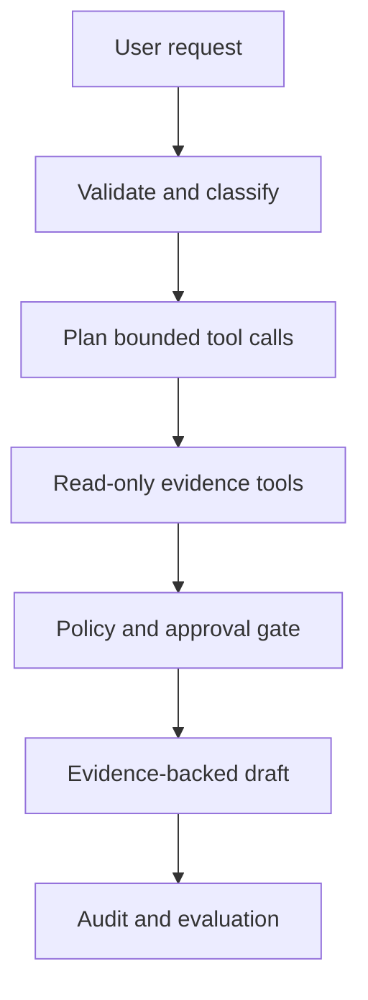

# Agentic Harness Engineering

**AIE2631 · 30-hour hands-on course · Python · Offline-friendly**

> From agentic vocabulary and coding workflows to a bounded, auditable Python agent.

This is the instructor-ready tutorial repository for **Agentic Harness Engineering**. One workspace (`AIE2631/`) contains five progressive modules, practical challenges, runnable source code, security exercises, and verification tests. Examples use **synthetic financial-sector requests only**. Explanations are written in English with Arabic teaching prompts where useful.

## Learning route

| Module | Time | Focus | Practical evidence |
|---|---:|---|---|
| [01 · Agentic foundations & jargon](AIE2631/module-01-foundations/README.md) | 4 h | Models, workflows, agents, harnesses, loops, graphs, context and evaluation | Architecture decision record + glossary quiz |
| [02 · Agentic coding & context contracts](AIE2631/module-02-agentic-coding/README.md) | 4 h | `AGENTS.md`, skills, MCP, tool contracts, specifications, coding-agent operations | Executable spec + skill and MCP inspection |
| [03 · Build the agent core](AIE2631/module-03-agent-core/README.md) | 8 h | Typed Python tools, bounded loop, state, SQLite, tests, local mock inference | Working single-agent CLI |
| [04 · Engineer the harness](AIE2631/module-04-harness-lab/README.md) | 10 h | Graph routing, checkpoints, policy gates, evaluations, observability, MCP adapter | End-to-end change-request triage demo |
| [05 · Secure agentic systems](AIE2631/module-05-security/README.md) | 4 h | Prompt injection, tool poisoning, permissions, data flow, approvals, audit and recovery | Threat model + adversarial verification |

## Capstone: Change-Request Evidence Assistant

A **local-first, read-only** assistant triages a fictional change request, finds supporting policy excerpts, and proposes a recommendation with citations. It cannot execute financial transactions, modify production systems, or approve its own recommendation. A deterministic local planner is supplied so learners do **not** need an API key, paid tokens, internet or a GPU. An optional model adapter can be implemented after the offline exercises.



## Quick start

Requirements: Python **3.11+**, Git, and no external services.

```bash
git clone <REPOSITORY_URL>
cd agentic-harness-engineering/AIE2631
python -m venv .venv
# Linux/macOS: source .venv/bin/activate
# Windows PowerShell: .venv\Scripts\Activate.ps1
python -m pip install -e '.[dev]'
python -m aie2631.cli demo
python -m pytest -q
```

If no package installation is possible, from `AIE2631/` run `python -m aie2631.cli demo` directly; only the test runner needs `pytest`.

## What is in the workspace?

```text
AIE2631/
  AGENTS.md                  # Repository-wide agent instructions
  .agents/skills/            # Example portable SKILL.md teaching artifact
  specs/                     # User story, acceptance tests, tool contracts
  data/                      # Synthetic requests and policy fragments
  src/aie2631/               # Python agent, harness, guardrails and CLI
  tests/                     # Behavioral, security and regression tests
  module-01-foundations/     # Vocabulary and mental models
  module-02-agentic-coding/  # Specs, instructions, MCP and skills
  module-03-agent-core/      # Building the core
  module-04-harness-lab/     # Graph, evaluation and review
  module-05-security/        # Threat modeling and hardening
```

## Teaching method

Each module has **Learn → Inspect → Build → Break → Verify → Reflect** checkpoints. Learners should work on separate Git branches, capture passing test output, and submit short evidence notes. The final assessment is not whether an LLM produced plausible text; it is whether a reproducible, authorized, tested workflow meets acceptance criteria.

### Delivery constraints

- 16 GB RAM and 40 GB free SSD are planning targets.
- Separate lab network, backup power, synthetic data, pinned offline wheels, and an instructor-installed Python environment.
- No learner needs to share a personal AI account. Optional coding-agent demonstrations should use institution-approved access and saved traces for outages.
- The instructor should verify model/service availability, license terms, data residency and institutional security approvals before any online lab.

## Instructor material

See [facilitator guide](AIE2631/INSTRUCTOR.md), [assessment rubric](AIE2631/ASSESSMENT.md), and [offline readiness](AIE2631/OFFLINE.md).

## Safety

**Education only**. The sample is intentionally not a production financial decision system. It uses synthetic data, read-only tool dispatch, explicit approval boundaries, limited iterations, and a local audit trail. Never point these demonstrations at live accounts, credentials, policy repositories or customer data.

## License

Training materials and source code are made available for the course; see [LICENSE](LICENSE) (MIT). Reuse third-party documentation subject to its own terms.
